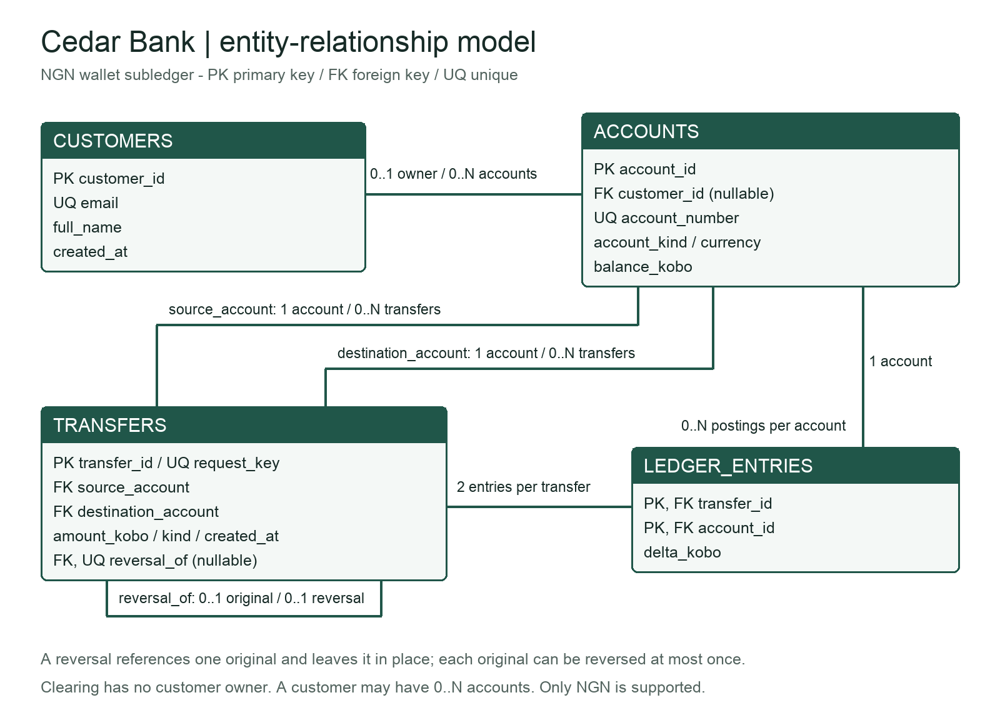

# Cedar Bank: database portfolio

MIT 8103 Advanced Database Systems | September cohort, 2026/2027

Unpersonalised repository summary.

GitHub repository (currently public): https://github.com/sarahbanks-12/MIVA-Assignment.

## Case study and scope

Cedar Bank is a simulated Nigerian fintech offering NGN wallets. Customers transfer money and check balances; support staff investigate complaints; operations staff reconcile postings; auditors inspect transaction history. The system stores customers, accounts, committed transfers and ledger entries. Its key operations are deposits, withdrawals, internal transfers, compensating reversals, transaction-history searches and balance reconciliation. All data are synthetic. Lending, foreign exchange and external settlement are outside this exercise.

## 1. Database design and modelling

The four relations separate customer details from accounts and financial history. Primary keys identify records; foreign keys connect them; unique account numbers and request keys prevent duplication. The ledger uses a composite key of transfer and account. Customer and transaction details are not repeated in posting rows, avoiding the update anomalies of a flat spreadsheet. The portfolio explains the functional dependencies and progression to third normal form.

Amounts are stored as whole kobo. Each transfer creates two equal and opposite postings, while customer balances must remain nonnegative. A clearing account represents deposits and withdrawals. The balance column is a deliberate cache of ledger totals; reconciliation checks it against the postings. This is a wallet subledger, not a complete bank general ledger.

Figure 1. Entity-relationship model. Full-size diagram, keys, constraints and normalisation: portfolio-1-database-design/.

---

# Queries and transaction correctness

## 2. Query processing and optimisation

The seed creates 5,000 customers, 5,001 accounts, 200,000 deposits and 400,000 ledger entries. The measured query returns the latest 20 incoming transactions for account 42. A composite B-tree index on destination account, descending timestamp and descending transfer ID supports both filtering and ordering. Other queries report daily deposits, customer balances, discrepancies and reversal history.

The benchmark runs one warm-up followed by seven EXPLAIN ANALYZE measurements per configuration, using the same query and connection. Returned rows match before and after indexing. Full plans, buffer statistics and results are saved in Portfolio 2 [2].

Measured result | Before | After
--- | --- | ---
Median execution time | 6.988 ms | 0.009 ms
Shared-buffer hits, last run | 2317 | 23
Shared-buffer reads, last run | 0 | 0

The baseline scans and sorts; the indexed plan reads matching entries in order and stops early. The index occupies 7.76 MiB and adds write-maintenance cost. These are warm-cache local timings, not network response times or a production capacity claim. The very small indexed times also limit the precision of any speedup ratio.

The saved baseline plan scans transfers and sorts matching rows; the indexed plan uses `transfers_destination_recent` with `destination_account = 42`. Complete text and JSON plans accompany the benchmark, including the actual measured timings.

## 3. Transactions and concurrency

The transfer function locks both accounts in ascending ID order, checks funds, changes balances and inserts the two postings within one transaction. COMMIT preserves all changes; ROLLBACK removes them. A unique request key and transaction-scoped advisory lock make identical retries return the original transfer ID. A reversal creates a new compensating transfer and leaves the original visible.

Two tests show why the control matters. An intentionally unsafe read/compute/write schedule ends at 60 instead of the expected 30. In the protected test, two sessions attempt to spend 70,000 kobo from a 100,000-kobo wallet. The second session is observed waiting; after the first commits, it sees 30,000 and rejects the request. No overdraft is created.

Isolation experiment [1] | First read | Second read
--- | --- | ---
READ COMMITTED; another session commits 200 | 100 | 200
REPEATABLE READ; same intervening update | 100 | 100

Run under REPEATABLE READ, the same lost-update schedule fails with SQLSTATE 40001 and must be retried. Portfolio 3 records 45 passing checks, including rollback, retries, invalid requests, permission denials, reversals, lock waiting and opposite-direction traffic. Final reconciliation finds no balance differences, no negative customer balances and a zero net ledger sum; a separate check confirms that it flags an injected one-kobo error. PostgreSQL supplies WAL-based durability [6]; no power-loss test was performed.

---

# NoSQL, replication and reflection

## 4. NoSQL and advanced data models

Redis stores customer preferences as a hash [4], transfer-attempt counts as expiring keys and synthetic review items as a sorted set. The implementation checks hash changes, score ordering and real expiry. Twenty concurrent increments return exactly 1 through 20. A Lua script combines increment and initial expiry atomically. These auxiliary values suit flexible, short-lived access; authoritative balances stay in PostgreSQL.

## 5. Distributed and cloud database exercise

A local primary streams WAL to a second PostgreSQL instance. A deposit of 12,345 kobo is committed on the primary and found on the standby; both subsequently contain 200,333 transfers. A standby write fails with SQLSTATE 25006. The evidence confirms asynchronous replication and read-only recovery mode, not a cloud deployment or failover test.

The proposed cloud layout separates primary and standby across availability zones. Transfer decisions use the primary because an asynchronous replica may be stale [3]. Safe promotion requires fencing the old writer; backups and restore tests are still necessary. Sharding by customer would complicate cross-customer transfers, so the current design retains one write authority. Both lab instances share one host and therefore one failure domain.

## Technical reflection

The ledger design made correctness easier to explain: every movement has two postings, and a reversal adds a new record instead of erasing the original. Storing a balance speeds up reads, but it also creates a responsibility to reconcile that balance with the ledger. The concurrency example was particularly useful because a result that looks correct in one session can fail when two sessions spend the same funds. Similarly, the index result is convincing because the execution plan shows less work, not simply because the reported time is smaller.

The hardest part of the assisted implementation was making the tests prove the intended behaviour. Some early rejection tests accepted any database error, so they could pass for the wrong reason. Checking the expected error code and message made them more reliable. The Redis expiry test also needed a delayed second increment to show that the window was not being reset. These corrections showed why passing tests need scrutiny, not just counting.

## AI use and submission status

OpenAI Codex assisted with design, code, tests and writing. Anthropic Claude (Claude Code) previously audited the local package. On 11 November Codex ran ten design checks; on 12 November it reran the integrated lab, verified 45 transaction checks, five Redis behaviours, replication and reconciliation, and updated this summary against the evidence. These checks were performed by agents; student-performed verification has not been confirmed. The personalised LMS PDF was not rebuilt in this review and LMS submission has not been performed. The repository remains public at the user's request; the brief calls for a private repository with assessor access. The implementation existed locally before these two review commits, which do not establish semester-long development.

## References

[[1] PostgreSQL 16: Transaction Isolation](https://www.postgresql.org/docs/16/transaction-iso.html)

[[2] PostgreSQL 16: Using EXPLAIN](https://www.postgresql.org/docs/16/using-explain.html)

[[3] PostgreSQL 16: Log-Shipping Standby Servers](https://www.postgresql.org/docs/16/warm-standby.html)

[[4] Redis: Redis hashes](https://redis.io/docs/latest/develop/data-types/hashes/)

[[6] PostgreSQL 16: Write-Ahead Logging](https://www.postgresql.org/docs/16/wal-intro.html)

Accessed 9 November 2026. Numbers match portfolio-1-database-design/REFERENCES.md, which also lists the full URLs, the Redis persistence and scripting sources [5, 8], tools and assessment-brief provenance.
