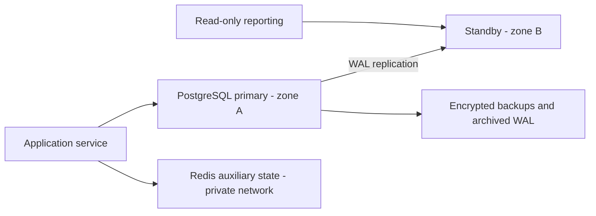

# Portfolio 5 - Distributed and cloud database exercise

## What was actually built

The lab uses PostgreSQL physical streaming replication: one writable primary on port 55503 and a read-only standby on port 55504. Both are separate processes on the same Mac. `setup-standby.sh` takes a base backup and writes standby recovery configuration. `../portfolio-5-distributed-cloud/scripts/test_replication.py` posts a small deposit on the primary, waits for that exact record on the standby, verifies both balanced postings on the standby, asserts streaming/asynchronous status, verifies recovery mode and confirms that a direct write on the standby is rejected.

`evidence/replication.json` contains the actual transfer ID, amount, WAL locations, connection state and write rejection. Equal row counts are an additional check, not the only evidence of replication. The replication mode is asynchronous. The measured observation interval includes polling and client work; it is not a reliable general measure of replication latency.

## Why replication is useful here

A separate standby can serve permitted reporting queries and provide a starting point for recovery from primary failure [3]. In this exercise the standby demonstrates replication mechanics only. Both processes share the host, disk and power supply, so the setup does not survive loss of that machine. No cloud deployment, automatic failover, standby promotion or recovery-time test is claimed.

Account authorization and transfer decisions must use the primary. An asynchronous standby may show an old balance or omit a just-committed transfer. A stale dashboard can be labelled with its last refresh time; a balance used to authorize spending cannot simply be treated as current.

## Proposed cloud layout

This is a deployment proposal. A managed PostgreSQL service with separate availability zones would reduce the operational burden, but the exact failover and durability guarantees must be checked for the selected service. Place database endpoints on a private network, restrict access by role, use TLS, keep secrets outside the repository and test backup restoration. A standby is not a backup: an accidental deletion can replicate too.

## Availability and consistency choices

With asynchronous replication, a primary can acknowledge a commit before the standby has received it. Promoting that standby after primary failure can therefore lose recently committed data. Synchronous replication can wait for standby acknowledgement; requiring remote apply can also wait for replay, with additional latency and dependence on standby availability [3]. The choice must follow a stated recovery-point objective, not an assumption that replication means zero data loss.

During a network partition, two independently writable copies of the same wallet would threaten the balance invariant. The proposed design keeps one write authority, fences an old primary before promotion and may refuse transfers while safe ownership is uncertain. Read-only reporting can remain available with a clear staleness policy. This favours consistent money movement over accepting writes on both sides of a partition.

Recovery-point and recovery-time targets remain design requirements to agree with operations. The local evidence cannot establish either target. Monitoring should cover WAL lag, replication-slot disk growth if slots are introduced, backup age and restoration success. This lab does not use a replication slot; a lagging standby can require rebuilding if needed WAL has been recycled.

## Sharding decision

Sharding by customer ID distributes customers, but transfers between customers can then span shards. A simple transaction no longer covers both wallets. Distributed transactions add coordination and failure handling, while a saga requires explicit intermediate states and compensating actions. For this dataset, a single primary with the measured index and a reporting standby is easier to reason about. Date-based partitioning of transaction history could help retention and maintenance later, but it is not the same as distributing wallets across machines and was not implemented here.

[3] PostgreSQL Global Development Group. *Log-Shipping Standby Servers*, PostgreSQL 16 documentation. https://www.postgresql.org/docs/16/warm-standby.html

## Reproduce this activity

The evidence above was regenerated on 12 November 2026. Follow the complete-lab commands in the root README; they create isolated services and run the activities in dependency order. Do not rerun the transaction fixture loader on an already populated lab.
